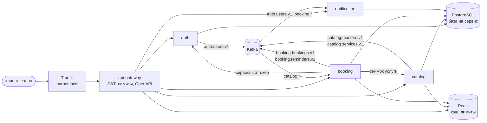

# Barber Platform

Микросервисная платформа онлайн-записи клиентов к парикмахерам. Клиент находит
салон и мастера, видит свободное время и записывается; салон ведёт графики
мастеров, услуги и цены; платформа подтверждает запись, напоминает о визите
и сообщает об отмене. Учебный проект, доведённый до рабочего состояния: пять
сервисов, Kubernetes, наблюдаемость, нагрузка и эксперименты на отказ.

**Стек:** Python 3.12, FastAPI, SQLAlchemy 2.x (async), PostgreSQL, Redis, Kafka,
Kubernetes (kind, Helm), OpenTelemetry, Prometheus, Grafana, Tempo, Loki, k6.

## Архитектура

Пять сервисов на FastAPI, у каждого своя база в общем PostgreSQL, и ни один не
читает чужую. Снаружи виден только `api-gateway`: он проверяет JWT, держит
лимиты запросов, собирает карточку мастера из двух сервисов и отдаёт сводный
OpenAPI. `auth` выпускает токены и публикует JWKS, по которому каждый сервис
проверяет подпись сам. `catalog` — салоны, мастера, услуги и цены. `booking` —
графики, свободные слоты и брони: занятость мастера охраняет
ограничение `EXCLUDE` в PostgreSQL, а не кэш и не блокировка. `notification`
отправляет письма и сообщения в Telegram. Изменения сервисы публикуют в Kafka
через transactional outbox, потребители дедуплицируют сообщения; синхронных
вызовов между сервисами два — `booking` берёт снимок услуги у `catalog`
и сервисный токен у `auth`. Redis — только кэш и лимиты: без него платформа
медленнее, но не ошибается.



Подробно — в [документации](docs/README.md): карта сервисов, контракты API,
модель данных, события, гарантии согласованности и 18 ADR.

## Что нужно

| Инструмент | Для чего | Проверено на |
|---|---|---|
| Docker с `docker compose` | локальный стенд, интеграционные тесты, kind | 29.8 |
| [uv](https://docs.astral.sh/uv/) | окружение и зависимости; Python 3.12 скачает сам | 0.11, в CI 0.12.8 |
| `make`, `curl`, `jq` | команды проекта и примеры ниже | — |
| [kind](https://kind.sigs.k8s.io/), `kubectl`, `helm` | только для Kubernetes | kind 0.32, kubectl 1.36, helm 3.19 (в CI 3.22) |

Память и время, честно:

| Что | Память | Первый запуск | Повторный |
|---|---|---|---|
| Compose-стенд (`make up`) | ~1,1 ГБ | ~1 мин: сборка пяти образов ~40 с, плюс скачивание базовых | ~15 с |
| Compose + наблюдаемость (`make obs-up`) | плюс до 2,2 ГБ (сумма `mem_limit` профиля) | плюс скачивание шести образов | ~15 с |
| kind (`make kind-up`) | узел около 3,7 ГБ | меньше, чем с наблюдаемостью | — |
| kind с наблюдаемостью (`OBSERVABILITY=1`) | узел 4,7–4,9 ГБ | ~28 мин на пустом кэше | ~14 мин |

Комфортно — от 16 ГБ памяти на машине; на 8 ГБ — compose-стенд или kind без
наблюдаемости. Почти всё время первого `make kind-up` уходит на скачивание
образов внутрь узла и `kind load`.

## Быстрый старт: compose

```bash
make sync    # окружение из lock-файла
make up      # PostgreSQL, Redis, Kafka, миграции и пять сервисов
make seed    # демо-данные через API: 3 салона, 12 мастеров, 100 клиентов, брони
```

Проверка:

```bash
curl localhost:8000/health/ready     # api-gateway
```

Swagger UI сводного OpenAPI всех сервисов — http://localhost:8000/docs.

Сервисы слушают и напрямую: api-gateway `8000`, auth `8001`, catalog `8002`,
booking `8003`, notification `8004`; PostgreSQL `5432`, Redis `6379`,
Kafka `9092`. Исходники смонтированы в контейнеры — правка файла перезапускает
сервис без пересборки образа. Миграции применяются одноразовыми контейнерами
`<service>-migrate` при подъёме; вручную — `make migrate`.

```bash
make logs    # логи стенда
make down    # остановить и удалить тома: следующий make up начнёт с пустых баз
```

Администратор стенда — `admin@barber.example` / `admin-local-password-1`
(`super_admin`, задан в `deploy/compose/docker-compose.yml`). Демо-клиенты seed
войти не могут: пароль у них случайный, а почта не подтверждена. Своего клиента
заводит сценарий ниже.

## Попробовать API

Весь путь клиента через gateway: регистрация, подтверждение почты, вход, поиск
слота, запись, отмена. Писем платформа локально не отправляет — `notification`
пишет их в свой лог, оттуда же берётся токен подтверждения.

```bash
API=http://localhost:8000/api/v1
LETTERS="docker compose -f deploy/compose/docker-compose.yml logs --no-log-prefix notification"
# в kind:
# API=http://barber.local/api/v1
# LETTERS="kubectl logs -n barber -l app.kubernetes.io/name=notification --tail=-1"

EMAIL=me-$RANDOM@example.com
PASSWORD=correct-horse-battery-7
PHONE=+7900$(printf '%07d' $((RANDOM * RANDOM % 10000000)))

# 1. регистрация и подтверждение почты
curl -s -X POST $API/auth/register -H 'Content-Type: application/json' \
  -d "{\"email\":\"$EMAIL\",\"phone\":\"$PHONE\",\"password\":\"$PASSWORD\"}" | jq
CONFIRM=$($LETTERS | jq -rR --arg to "$EMAIL" \
  'fromjson? | select(.template == "email_confirmation" and .address == $to) | .body' \
  | grep -o 'token=[A-Za-z0-9_-]*' | tail -1 | cut -d= -f2)
curl -s -X POST $API/auth/confirm-email -H 'Content-Type: application/json' \
  -d "{\"token\":\"$CONFIRM\"}" | jq

# 2. вход
TOKEN=$(curl -s -X POST $API/auth/login -H 'Content-Type: application/json' \
  -d "{\"email\":\"$EMAIL\",\"password\":\"$PASSWORD\"}" | jq -r .access_token)
AUTH="Authorization: Bearer $TOKEN"

# 3. салон, мастер, услуга и первый свободный слот на неделю вперёд
SALON=$(curl -s $API/salons | jq -r '.items[0].id')
MASTER=$(curl -s $API/salons/$SALON/masters | jq -r '.items[0].id')
SERVICE=$(curl -s $API/masters/$MASTER/card | jq -r '.master.services[0].service_id')
SLOT=$(curl -s -H "$AUTH" "$API/availability?master_id=$MASTER&service_id=$SERVICE&date_from=$(date -d tomorrow +%F)&date_to=$(date -d '+7 days' +%F)" \
  | jq -r '[.days[].slots[]][0]')

# 4. запись, свои брони, отмена
BOOKING=$(curl -s -X POST $API/bookings -H "$AUTH" -H 'Content-Type: application/json' \
  -H "Idempotency-Key: $(uuidgen)" \
  -d "{\"master_id\":\"$MASTER\",\"service_id\":\"$SERVICE\",\"start_at\":\"$SLOT\"}" | jq -r .id)
curl -s -H "$AUTH" $API/bookings | jq '.items[] | {id, status, start_at, service_name}'
curl -s -X POST $API/bookings/$BOOKING/cancel -H "$AUTH" | jq '{status, cancelled_at}'

# 5. письма клиенту: подтверждение почты, запись, отмена
$LETTERS | jq -cR --arg to "$EMAIL" 'fromjson? | select(.address == $to) | {template, address}'
```

Письмо о записи приходит через Kafka, поэтому появляется в логе через секунду-две
после ответа API. Повторная запись с тем же `Idempotency-Key` вернёт ту же бронь,
а не вторую. Если `SLOT` пуст — у мастера нет свободного времени на неделе:
возьмите другую услугу или сдвиньте `date_from`.

## Kubernetes в kind

```bash
make kind-up                  # кластер, Traefik, infra, пять сервисов, демо-данные
make kind-up OBSERVABILITY=1  # то же плюс Prometheus, Alertmanager, Grafana, Tempo, Loki, Alloy
make kind-down                # удалить кластер
```

Платформа отвечает на `http://barber.local` — нужна строка в `/etc/hosts`:

```bash
echo '127.0.0.1 barber.local' | sudo tee -a /etc/hosts
curl http://barber.local/api/v1/salons
# без /etc/hosts:
curl --resolve barber.local:80:127.0.0.1 http://barber.local/api/v1/salons
```

Сценарий из «Попробовать API» работает и здесь — с `API` и `LETTERS` для kind.
Пароль администратора генерируется при подъёме и хранится только в кластере:

```bash
kubectl get secret auth-env -n barber -o jsonpath='{.data.BOOTSTRAP_ADMIN_PASSWORD}' | base64 -d
```

Повторный `make kind-up` безопасен: недостающее создаётся, существующее
остаётся, пересобранные образы выкатываются. Секреты генерируются прямо
в кластер (`scripts/gen_secrets.sh`), в файлы не пишутся. Демо-данные — Job
`api-gateway-seed` (`scripts/seed.py`). Сервисы `api-gateway`, `booking`
и `catalog` держат по два пода и масштабируются HPA до трёх.

**Прогон 03.10.2026** (WSL2, 12 ядер, 16 ГБ для WSL, Docker 29, kind 0.33,
Kubernetes 1.37, `OBSERVABILITY=1`):

| | Время |
|---|---|
| С нуля, на пустом кэше образов в узле | 28 мин 20 с |
| из них: кластер · Traefik и metrics-server · сборка и загрузка образов | 1 мин 15 с · 1 мин 45 с · 6 мин 20 с |
| из них: секреты и infra · наблюдаемость · пять сервисов и seed | 6 мин · 8 мин 20 с · 4 мин 40 с |
| Повторный запуск на живом кластере | 13 мин 40 с |

Узел `kind` со всеми тремя namespace после seed занимает 4,7 ГБ памяти;
без `OBSERVABILITY=1` — примерно на 1 ГБ меньше.

**Известное ограничение:** etcd узла держит данные в памяти (на диске WSL
записи шли по 150–450 мс, и control plane перезапускался). После перезапуска
Docker кластер не поднимется — пересоздайте его: `make kind-down kind-up`.

## Тесты

```bash
make lint      # ruff check + ruff format --check
make type      # mypy --strict
make test      # все тесты, включая интеграционные на testcontainers
make test-unit # только те, которым Docker не нужен
```

Интеграционные тесты поднимают настоящие PostgreSQL, Redis и Kafka через
`testcontainers`; без Docker они пропускаются. Среди них — тест гонки: двадцать
одновременных записей на один слот, ровно одна успешна. Ещё три проверки,
которые CI гоняет отдельными job'ами:

```bash
uv run pytest -m fuzz tests/contract/test_schemathesis.py  # schemathesis через gateway по сводному OpenAPI
make alerts-check   # правила алертов, их юнит-тесты и маршрутизация (promtool, amtool; нужен Docker)
make helm-check     # helm lint и kubeconform по всем сервисам (нужны helm и kubeconform)
```

`make check` прогоняет хуки pre-commit по всему репозиторию; `make hooks`
ставит их в клон. Полный список команд — `make help`.

## Нагрузка

```bash
make kind-up OBSERVABILITY=1   # без метрик не будет графиков HPA и p95 по сервисам
make loadtest                  # 7 минут: разгон до 50 RPS и удержание; падает, если нарушен SLO
```

Сценарий — [loadtest/k6/booking_flow.js](loadtest/k6/booking_flow.js): 80 % поиск
слотов, 15 % карточка мастера, 5 % запись. k6 запускается из образа, клиентов
сценария `make loadtest` регистрирует сам. Профиль меняется переменными:
`make loadtest RATE=20 HOLD=1m`. Брони настоящие, и прогон расходует слоты:
после одного-двух прогонов сдвиньте окно — `make loadtest DAYS_AHEAD=28`.
Подробности — [loadtest/k6/README.md](loadtest/k6/README.md).

Результаты на 50 RPS: 0 % ошибок, p95 поиска слотов 21–32 мс, p95 записи
26–39 мс при SLO 1 с и 500 мс — [docs/15-load-test-results.md](docs/15-load-test-results.md).
Падение пода, rolling update, остановка Kafka и Redis под нагрузкой прошли
без единой ошибки у клиента — [docs/16-failure-drills.md](docs/16-failure-drills.md).

## Наблюдаемость

Дашборды Grafana — **System overview** (RPS, доля 5xx, p95 по сервисам), **Async**
(outbox, лаг консьюмеров, DLQ, планировщики) и **Business** (брони, отмены и неявки,
конфликты за слот, загрузка мастеров, уведомления). Вход без логина.

| Где | Compose: `make obs-up` | kind: `make kind-up OBSERVABILITY=1` |
|---|---|---|
| Grafana | http://localhost:3000 | `make kind-grafana` → http://localhost:3000 |
| Prometheus | http://localhost:9090 | `kubectl port-forward -n observability svc/monitoring-prometheus 9090` |
| Alertmanager | http://localhost:9093 | `kubectl port-forward -n observability svc/monitoring-alertmanager 9093` |
| Tempo API | http://localhost:3200 | в Grafana: Explore → Tempo |
| Alloy, граф сбора логов | http://localhost:12345 | — |

`make obs-down` убирает профиль, сервисы остаются и перезапускаются без
трейсинга. Дашборды — `deploy/observability/dashboards/`, алерты —
`deploy/observability/alerts/` и `deploy/observability/alertmanager.yaml`; они общие
для compose и кластера, в Grafana правятся только через git.

**Ручная проверка после `make obs-up`:**

1. Prometheus → Status → Targets: пять целей `UP`.
2. Grafana → Connections → Data sources: Prometheus, Tempo, Loki, Alertmanager.
3. Трафик: `make seed` и сценарий из «Попробовать API». Дашборды
   System overview и Business показывают данные, Async — прошедшие через
   outbox события.
4. Grafana → Explore → Tempo, запрос
   `{ resource.service.name = "notification" && name =~ "consume.*" }`:
   трейс начинается с `POST /api/v1/auth/register` в `auth`, внутри —
   `create auth.users.v1` и под ним `consume auth.users.v1` в `notification`.
   Span `publish auth.users.v1` relay лежит отдельным трейсом со ссылкой
   на `create` — так задумано, см. [docs/11-observability.md](docs/11-observability.md#трассировка).
5. Логи трейса: у span'а из шага 4 кнопка **Logs for this span** открывает
   записи Loki всего трейса из всех сервисов. Обратно: в записи Loki поле
   `trace_id` → **Open the trace**. Метки Loki — только `service`, `env`,
   `level`; `trace_id` — structured metadata, `correlation_id` и `user_id` —
   поля записи.
6. Алерт на DLQ: «ядовитое» сообщение в топик, который читает `notification`,

   ```bash
   echo '{ not json' | docker compose -f deploy/compose/docker-compose.yml exec -T kafka \
     kafka-console-producer --bootstrap-server localhost:9092 --topic booking.bookings.v1
   ```

   В течение минуты Alertmanager (http://localhost:9093) показывает
   `DeadLetters` с `reason=invalid_message`, дашборд Async — сообщение в DLQ.
7. Алерт на вставший outbox: `docker compose -f deploy/compose/docker-compose.yml stop kafka`,
   затем запись, которая пишет событие (регистрация из «Попробовать API»).
   На дашборде Async «Waiting in the outbox» растёт в течение 5 с, через
   ~4,5 минуты срабатывает `OutboxNotDraining`. После `... start kafka` outbox
   пустеет и алерт гаснет.

## Конфигурация

Все настройки — переменные окружения, читаются через `pydantic-settings`.
Полный перечень с описанием — в [.env.example](.env.example). Compose-стенд
и kind задают их сами; `.env` нужен, только если запускать сервис вне
контейнера:

```bash
cp .env.example .env
```

У секретов, адреса базы, Redis и брокера значений по умолчанию нет: сервис
падает на старте, если переменная не задана. Файл `.env` в git не попадает.
Чтобы `notification` слал сообщения в Telegram, а не в лог, задайте
`TELEGRAM_BOT_TOKEN` и `TELEGRAM_BOT_USERNAME`. В kind токен `make kind-up`
берёт из окружения и кладёт в Secret, имя бота — в
`deploy/helm/values/notification.yaml`.

## Структура

```
libs/common/          # шасси barber_common: конфиг, логи, ошибки, БД, Kafka, outbox, auth, health
services/             # api-gateway, auth, catalog, booking, notification
deploy/compose/       # локальный стенд и профиль наблюдаемости
deploy/helm/          # чарт сервиса, чарт infra, чарт наблюдаемости, values по сервисам
deploy/kind/          # кластер kind и Traefik
deploy/observability/ # дашборды и алерты, общие для compose и кластера
loadtest/k6/          # нагрузочный сценарий
scripts/              # подъём kind, секреты, топики, миграции, seed
tests/                # контрактные, e2e и deploy-тесты всей платформы
docs/                 # проектная документация и ADR
```

## Документация

| | |
|---|---|
| [docs/README.md](docs/README.md) | оглавление и три решения, определяющие систему |
| [docs/03-services.md](docs/03-services.md) | карта сервисов и владение данными |
| [docs/04-api-contracts.md](docs/04-api-contracts.md) | эндпоинты, ошибки, аутентификация |
| [docs/05-data-model.md](docs/05-data-model.md) | таблицы и главный инвариант |
| [docs/07-events-and-kafka.md](docs/07-events-and-kafka.md) | топики, события, доставка, DLQ |
| [docs/10-infrastructure.md](docs/10-infrastructure.md) | compose, Helm, Kubernetes, CI |
| [docs/11-observability.md](docs/11-observability.md) | метрики, трейсы, логи, алерты |
| [docs/17-design-vs-reality.md](docs/17-design-vs-reality.md) | что разошлось с проектом и почему |
| [docs/adr/](docs/adr/README.md) | 18 архитектурных решений |
