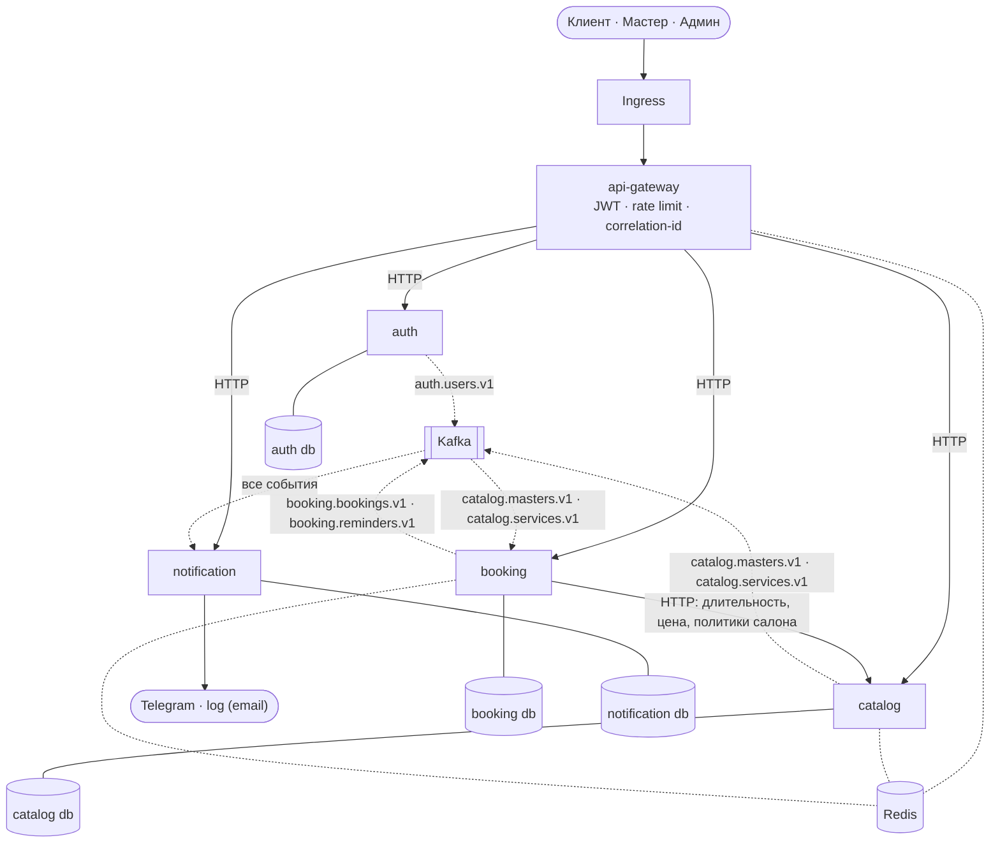

# Карта сервисов

Пять сервисов. Граница проведена по транзакционной согласованности: всё, что должно
меняться атомарно, лежит в одном сервисе и в одной базе.



Сплошные стрелки — синхронный HTTP, пунктир — события Kafka и кэш.

## Ответственность и владение данными

| Сервис | Ответственность | Владеет данными | Зависит от |
|---|---|---|---|
| `api-gateway` | Единая точка входа: проверка JWT, rate limit, correlation-id, проксирование, один агрегирующий эндпоинт карточки мастера | — (только Redis) | auth (JWKS), catalog, booking |
| `auth` | Регистрация, подтверждение email, пароли, выпуск JWT RS256, refresh с ротацией, роли, JWKS, m2m-токены | Пользователи, роли, refresh-токены, ключи подписи | — |
| `catalog` | Витрина: салоны, мастера, услуги, привязка мастер × услуга, политики салона | Салоны, мастера (профиль), услуги, `master_services` | — |
| `booking` | Графики, расчёт доступности, жизненный цикл записи, планировщик напоминаний. **Держит главный инвариант системы** | Шаблоны графиков, исключения, настройки мастера, брони | catalog (синхронно), Kafka (`catalog.masters.v1` — настройки мастера и каскад, `catalog.services.v1` — кэш) |
| `notification` | Доставка уведомлений: адаптеры log и Telegram (email всегда уходит в log — почтового провайдера нет), дедупликация, ретраи, DLQ сдавшихся; предпочтения каналов и привязка Telegram через API | Контакты и предпочтения получателей, журнал отправок, коды привязки Telegram | Kafka (`auth.users.v1`, `booking.*`), Telegram Bot API |

## Правила, которым подчиняются границы

1. **Межсервисных внешних ключей нет.** `master_id` в `booking` — просто UUID.
   Ссылочная целостность обеспечивается валидацией при записи и каскадами через события.
2. **Данные читаются у владельца или из снимка.** `booking` не хранит копию каталога:
   он либо спрашивает `catalog` синхронно (с кэшем), либо использует снимок,
   сохранённый в брони на момент создания.
3. **Репликация данных допускается только там, где она оправдана автономностью.**
   Единственный такой случай — таблица контактов в `notification`: уведомления должны
   уходить, даже когда `auth` недоступен.
4. **Событие меняет бизнес-состояние другого сервиса только в одном месте:**
   `master.deactivated` → каскадная отмена будущих броней. Остальные потребители
   ведут собственные агрегаты или кэш: `master.created`/`master.updated` —
   `master_settings` в `booking`, `user.*` — `recipients` в `notification`,
   `catalog.*` — поколения кэша `booking`.

## Где живёт мастер

Мастер разделён между двумя сервисами по принципу «кто он» / «когда он работает»:

| В `catalog` | В `booking` |
|---|---|
| Профиль: имя, фото, специализация, привязка к салону | `master_settings`: буфер, таймзона, флаг активности, `user_id` (кто владеет графиком) |
| `master_services`: какие услуги оказывает, цена и длительность | `schedule_templates`: недельный шаблон |
| Флаг `is_active` как источник истины | `schedule_exceptions`: выходные, перерывы |

Строка `master_settings` в `booking` создаётся по событию `master.created`.
Это не реплика профиля, а собственный агрегат сервиса, ключом которого служит `master_id`.

## Почему нет отдельного scheduling

Инвариант «интервалы записей одного мастера не пересекаются» защищён ограничением
PostgreSQL. Ограничение работает только внутри одной таблицы одной базы — значит,
владелец броней обязан владеть и проверкой занятости. Отдельный `scheduling` размазал
бы инвариант по двум базам и потребовал бы распределённой блокировки, то есть замены
гарантии на договорённость. См. [ADR-0001](adr/0001-merge-scheduling-into-booking.md).

## Организация репозитория

Монорепозиторий, отдельный Docker-образ на сервис:

```
services/
  api-gateway/    auth/    catalog/    booking/    notification/
libs/
  common/         # конфиг, structlog, OTel, ошибки RFC 9457, Kafka-обвязка,
                  # auth-мидлварь, схемы событий, outbox-relay
deploy/
  helm/           # chart сервисов, infra, observability + values
  compose/        # docker-compose для разработки
  kind/           # кластер, Traefik, metrics-server
  observability/  # алерты, дашборды, Alertmanager — общие для compose и kind
scripts/          # kind_up, infra_up, create_topics, gen_secrets, seed, loadtest
loadtest/k6/      # нагрузочный сценарий
tests/            # сквозные, контрактные, deploy, docs
docs/
```

`libs/common` ставится как локальный пакет. Сервисы остаются независимо деплоимыми.
