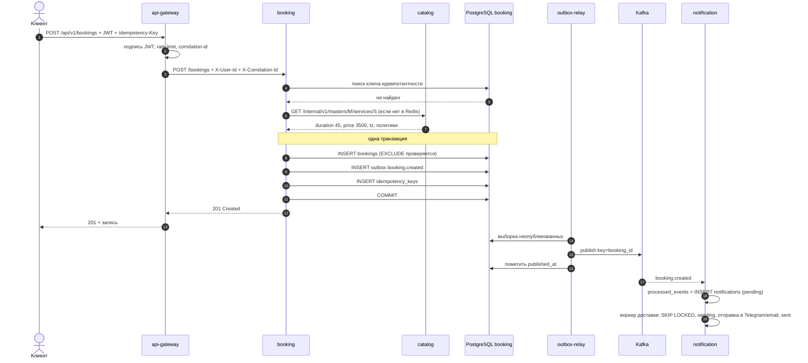
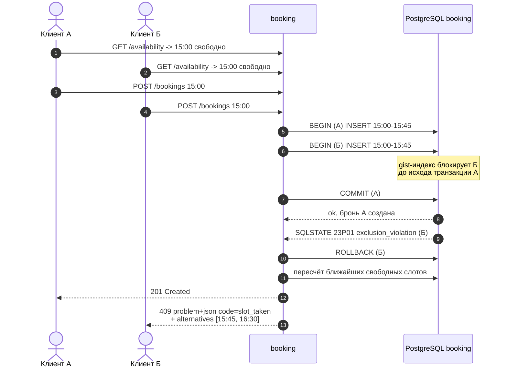
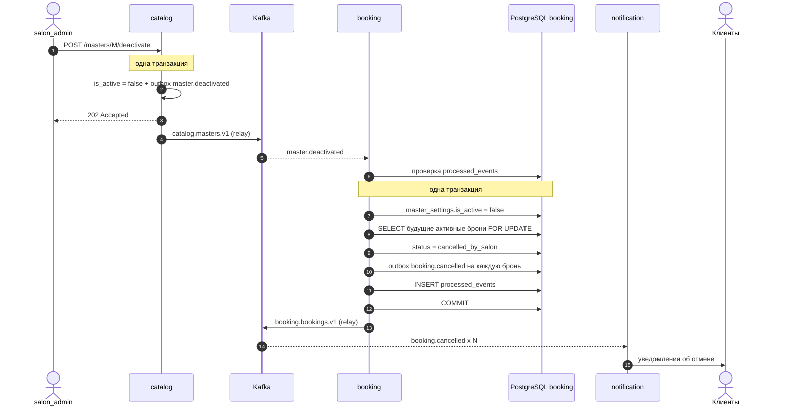

# Ключевые сценарии

Три диаграммы, которые описывают систему целиком: удачный путь, конкурентный конфликт
и каскадная компенсация через события.

## 1. Успешная запись

Ответ клиенту не ждёт Kafka: гарантию даёт outbox в той же транзакции.

## 2. Гонка двух клиентов за один слот

Арбитр — только база. Redis-кэш доступности в этом сценарии не участвует.
Этот сценарий проверяется автотестом на этапе Э3 — см. [12-testing.md](12-testing.md).

## 3. Деактивация мастера и компенсация

Ответ администратору — `202 Accepted`: отмена броней произойдёт асинхронно,
обычно за доли секунды. Повторная доставка события безопасна.
