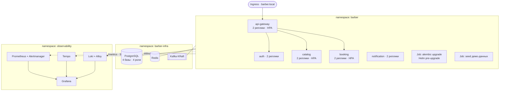

# Инфраструктура и развёртывание

Два режима: `docker-compose` для повседневной разработки и `kind` для проверки полного
k8s-развёртывания. Дублирование конфигурации принято сознательно — цена за быстрый
цикл правки.



Три пространства имён разворачиваются по отдельности — это важно при нехватке памяти
на локальной машине.

## Решения

| Аспект | Решение |
|---|---|
| Шаблонизация | Helm: **один общий chart**, параметризуемый через values; пять релизов из одного шаблона + values-файлы `local` / `prod` |
| Инфраструктура | Свой chart `infra` на образах compose: PostgreSQL, Redis, Kafka в режиме KRaft; одна реплика, без персистентности локально — кроме лога Kafka, который в `kind` лежит на PVC (`kafka.persistence`), чтобы остановленный брокер возвращался с топиками и offsets; автосоздание топиков выключено |
| Миграции | k8s Job по Helm-хуку `pre-install` / `pre-upgrade`; приложение на старте сверяет версию схемы и падает при расхождении |
| Конфигурация | `pydantic-settings` из переменных окружения; ConfigMap для настроек, Secret для паролей и ключей; в git только `.env.example`. Изменённый ConfigMap перекатывает поды (аннотация `checksum/config`) |
| Пробы | `startupProbe` и `livenessProbe` — `/health/live` (только процесс), `readinessProbe` — `/health/ready` (проверяет только базу, дедлайн проверки 2 с — `HEALTH_CHECK_TIMEOUT_SECONDS`; Redis и Kafka сознательно нет — без них сервис деградирует, но отвечает; у гейтвея базы нет, проверок нет). Тайминги в values `probes.*`: startup — раз в 2 с, до 30 провалов (60 с на старт); liveness — раз в 10 с, таймаут 2 с, 3 провала; readiness — раз в 5 с, таймаут 3 с, 2 провала |
| Выкатка | `RollingUpdate` с `maxUnavailable: 0`, `maxSurge: 1` — мощность не падает ниже числа реплик |
| Завершение | Пауза `preStop`, пока под уходит с эндпоинтов; затем `SIGTERM`: uvicorn дожидается запросов, консьюмеры коммитят сообщение в работе и выходят из группы, пулы закрываются. Бюджет — см. «Завершение пода» |
| Масштабирование | HPA (`autoscaling/v2`) по CPU (70 % от request; понижение — после 300 с стабилизации) для `api-gateway`, `booking` и `catalog`: 2–5 реплик, в `kind` 2–3 (два пода — чтобы потеря одного не давала ошибок клиенту; catalog — потому что без кэша на нём весь поток запросов доступности, см. [16-failure-drills.md](16-failure-drills.md)); с HPA `replicas` в Deployment не пишется. PodDisruptionBudget `maxUnavailable: 1` на всех пяти (не `minAvailable: 1`: с одной репликой тот запрещал бы любой drain); requests/limits на всех подах и Job'ах — без них chart не рендерится. Источник CPU — metrics-server |
| Ingress | Traefik (hostPort 80/443 узла kind, только на `127.0.0.1`), хост `barber.local` → `api-gateway`, все пути; Ingress есть только у гейтвея. Гейтвей доверяет одному прокси (`TRUSTED_PROXY_HOPS=1`). ingress-nginx не используется — проект закрыт в марте 2026 |
| Реплики | 2 на сервис в values сервиса (у сервисов с HPA — минимум HPA). В `kind` (`local.yaml`) у auth и notification — 1, у gateway, booking и catalog — 2–3 по HPA |
| Под | Не root (uid/gid 10001), `readOnlyRootFilesystem`, `capabilities: drop ALL`, seccomp `RuntimeDefault`, без токена ServiceAccount и без service links; `/tmp` — `emptyDir` на 64 МиБ |

## Локальная разработка

```
deploy/compose/docker-compose.yml      # PostgreSQL, Redis, Kafka, миграции, сервисы с hot-reload
deploy/compose/docker-compose.obs.yml  # опциональный профиль наблюдаемости
```

| Контейнер | Порт на хосте |
|---|---|
| `postgres` (17-alpine; 4 базы, 4 роли — тем же `init-databases.sh`, что в кластере) | 5432 |
| `redis` (7-alpine) | 6379 |
| `kafka` (cp-kafka 7.6.0, KRaft, 3 партиции на топик) | 9092 (внутри сети — `kafka:29092`) |
| `api-gateway` · `auth` · `catalog` · `booking` · `notification` | 8000 · 8001 · 8002 · 8003 · 8004 |
| `<service>-migrate` — `alembic upgrade head` одноразовым контейнером | — |

Сервис стартует после своей миграции (`service_completed_successfully`).
Исходники смонтированы поверх пакета, uvicorn `--reload`. `LOG_LEVEL=DEBUG`,
трейсинг выключен. Ключ подписи auth — файл `deploy/compose/secrets/`
из `make keys`. Отличия от кластера: топики Kafka создаются автоматически,
у PostgreSQL и Kafka именованные тома — живут до `make down` (`down -v`).

`make up` / `make down` / `make logs`, `make migrate`, `make seed`.
Профиль наблюдаемости — второй compose-файл (не `profiles:`), всегда поверх
основного: `make obs-up` / `make obs-down`. Он поднимает Prometheus (9090),
Alertmanager (9093), Grafana (3000, без логина), Tempo (3200, OTLP 4317),
Loki (3100), Alloy (12345), у каждого `mem_limit`, и включает в сервисах
`OTLP_ENABLED`; `obs-down` пересоздаёт сервисы без трейсинга.

Цикл разработки — в compose. Перед закрытием каждого этапа обязателен прогон
в `kind`: это ловит расхождения между compose и Helm, которые иначе накапливаются.

## Helm

```
deploy/helm/
  service/              # один chart на все пять сервисов
    templates/          # Deployment, Service, ConfigMap, ServiceAccount, PDB,
                        # Job миграций; HPA, Ingress, ServiceMonitor и Job seed —
                        # по флагам values
    values.yaml         # дефолты
  values/
    common.yaml         # общее для пяти релизов: реестр, адреса инфраструктуры, issuer
    api-gateway.yaml    auth.yaml    catalog.yaml
    booking.yaml        notification.yaml
    local.yaml          # переопределения для kind: 1 реплика, малые лимиты, образы compose
    observability.yaml  # overlay при поднятой наблюдаемости: трейсы в Tempo
  infra/                # PostgreSQL, Redis, Kafka в namespace barber-infra
    files/init-databases.sh   # базы и роли; его же монтирует compose
  observability/        # Tempo, Loki, Alloy, PrometheusRule, дашборды, маршрутизация
    files/              # симлинки на deploy/observability и конфиги compose
    kube-prometheus-stack.yaml  # values upstream-чарта
deploy/kind/            # кластер, Traefik, metrics-server
```

Сервис описывается только своим values-файлом: образ, порт, переменные окружения,
ключи Secret, нужен ли Job миграций, какие топики слушает. Релиз ставится так:

```
helm upgrade --install booking deploy/helm/service -n barber \
  -f deploy/helm/values/common.yaml -f deploy/helm/values/booking.yaml \
  [-f deploy/helm/values/local.yaml] --set image.tag=<sha>
```

Chart не создаёт Secret'ы, а ссылается на `<service>-env` с явно перечисленными
ключами (`secret.keys`); под без limits или без тега образа не рендерится.

Инфраструктура: `make infra-up` (namespace, chart `infra`, топики через
`scripts/create_topics.sh`), `make infra-check` — каждая роль видит только свою базу.
Проверка манифестов: `make helm-check` (`helm lint` + `kubeconform` по схемам
Kubernetes узла kind, ServiceMonitor и PrometheusRule — по каталогу CRD datreeio).
Локально нужны `helm` 3.22, `kubeconform` 0.8, `kind` 0.33.

## kind одной командой

`make kind-up` (`scripts/kind_up.sh`): кластер из `deploy/kind/cluster.yaml`,
Traefik и metrics-server, сборка образов compose и `kind load`, секреты и infra,
пять релизов с `--wait` (гейтвей последним — на нём Job seed), проверка
`http://barber.local/health/ready` через Ingress. `OBSERVABILITY=1` добавляет
namespace `observability` (`scripts/obs_up.sh`) и включает трейсинг сервисов.
Повторный запуск безопасен: всё — `upgrade --install` или `apply`; пересобранный
образ выкатывается (аннотация с id образа), неизменный — нет. `make kind-down`
удаляет кластер. etcd узла держит данные в tmpfs: на диске WSL запись шла
по 150–450 мс, и controller-manager со scheduler перезапускались. Время
прогона и память — в README.

## Наблюдаемость в кластере

`kube-prometheus-stack` (релиз `monitoring`): оператор, Prometheus, Alertmanager,
Grafana, kube-state-metrics; правила и дашборды Kubernetes-миксина, node-exporter
и скрейп компонентов control plane выключены — на ноутбуке они дороже самой
платформы. Свой chart `deploy/helm/observability` — Tempo, Loki и Alloy на
образах и конфигах compose, `PrometheusRule` из `rules.yaml`, ConfigMap'ы
дашбордов для sidecar Grafana, Secret маршрутизации Alertmanager. Файлы общие
с compose: в `files/` лежат симлинки, Helm читает их содержимое.

- Сервис собирается по `ServiceMonitor` из chart сервиса; шаблон рендерится,
  только если в кластере есть CRD оператора, так что релиз без наблюдаемости
  ставится как есть. Метку `service` оператор ставит сам (имя Service), `env` —
  relabeling. Дашборды и алерты работают без правок.
- Alloy читает логи подов `barber` через API Kubernetes (Role только на этот
  namespace), метки те же, что в compose: `service`, `env`, `level`.
- Tempo режет блок трейсов на 100 МБ или 5 минутах, лимит пода 1 ГиБ: с
  настройками по умолчанию (блок до 500 МБ на 30 минут в памяти) на 50 RPS он
  падал по OOM.
- Grafana — `make kind-grafana` (port-forward на `localhost:3000`, куда ведут
  ссылки алертов), вход без логина, как в compose.

## Завершение пода

Kubernetes убирает удаляемый под из эндпоинтов параллельно с `SIGTERM`, а не до него,
и до каждого узла это доходит не мгновенно. Поэтому:

| Фаза | values `shutdown.*` | По умолчанию | Что происходит |
|---|---|---|---|
| Пауза `preStop` | `preStopSeconds` | 5 с | Под продолжает обслуживать, пока его снимают с балансировки |
| Запросы | `requestsSeconds` | 15 с | uvicorn не принимает новые соединения, дожидается текущих (`UVICORN_TIMEOUT_GRACEFUL_SHUTDOWN`); больше таймаута чтения гейтвея |
| Фоновая работа | `backgroundSeconds` | 30 с | readiness → `draining`, консьюмеры коммитят сообщение в работе и выходят из группы, relay и воркеры останавливаются; не меньше лимита на одно сообщение |
| Запас | `marginSeconds` | 5 с | До `SIGKILL` |

`terminationGracePeriodSeconds` — сумма фаз, её считает chart. Сервис пишет в лог
`service stopped` с длительностью каждой фазы.

## Миграции

Job запускается Helm-хуком до обновления Deployment:

```yaml
annotations:
  "helm.sh/hook": pre-install,pre-upgrade
  "helm.sh/hook-weight": "-5"
  "helm.sh/hook-delete-policy": before-hook-creation
```

Приложение при старте выполняет `alembic current` и сравнивает с `alembic heads`.
При расхождении — падение на старте, а не работа на несовместимой схеме.

Правило миграций: **только совместимые вперёд изменения**. Удаление колонки —
две выкладки: сначала код перестаёт её читать, потом миграция удаляет.

## Секреты

`scripts/gen_secrets.sh` (его вызывает `infra_up.sh`) генерирует значения в памяти
и применяет их в кластер, ничего не записывая на диск: `postgres-credentials`
(barber-infra), `<service>-env`, `auth-signing-key`. Значения идут base64 на stdin
`kubectl apply --server-side` — не в аргументах процессов и без аннотации
last-applied. Повторный запуск сохраняет существующие значения (иначе новый ключ
подписи обесценил бы выданные токены), `--rotate` перевыпускает всё.
`TELEGRAM_BOT_TOKEN` из окружения заменяет сохранённый. Что каждый ключ, который
читает релиз, создаётся генератором, проверяет `tests/deploy/test_secrets.py`
на подставном `kubectl`. В репозитории — только `.env.example`;
`scripts/check-secrets.sh` гоняется и в pre-commit, и в CI.

## CI

GitHub Actions:

```
lint      ruff check + ruff format --check + scripts/check-secrets.sh
types     mypy (код и тесты сервисов)
test      pytest -m "not fuzz" + testcontainers (PostgreSQL, Redis, Kafka), покрытие
fuzz      schemathesis по сводному OpenAPI (tests/contract/test_schemathesis.py)
alerts    make alerts-check — promtool по правилам и их тестам
helm      make helm-check — helm lint + kubeconform
changes   какие сервисы затронуты
build     multi-stage Docker build на изменённые сервисы, кэш GHA;
          push в GHCR с тегом по SHA — только на main (отдельного job publish нет)
```

Зависимости — `uv` (существенно быстрее poetry на CI). Тег по SHA даёт
воспроизводимость и честный откат.

## Демо-данные

`scripts/seed.py`: 3 салона (Москва, Екатеринбург, Новосибирск), 12 мастеров,
15 услуг, недельные графики и выходные на месяц вперёд, 100 клиентов, брони
на две недели (по 12 на мастера, около 10 % отменены салоном). Локально —
`make seed`, в `kind` — Job-хук `post-install,post-upgrade` релиза гейтвея
(скрипт приходит ConfigMap'ом через `--set-file`, образ — гейтвея).

- Ходит в публичный API сервисов напрямую, не через гейтвей: лимиты гейтвея
  (3 регистрации в час с адреса, 5 броней в минуту) рассчитаны на человека.
- Входит как первый `super_admin`, которого auth заводит при старте из
  `BOOTSTRAP_ADMIN_*` (Secret `auth-env`); брони ставит администратор
  на `client_user_id` клиентов.
- Повторный запуск ничего не создаёт: салоны, услуги и мастера находятся по
  имени; существующий клиент отвечает `409` без id, поэтому брони создаются
  только в том запуске, что зарегистрировал клиентов. Почта демо-аккаунтов
  (`*.barber.example`) не подтверждается, пароли случайные и выбрасываются.
- `tests/seed/test_seed.py` гоняет seed дважды против настоящих auth, catalog
  и booking на uvicorn поверх testcontainers.
