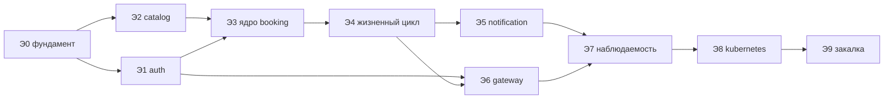

# План реализации

Десять этапов по 3–5 дней, ориентировочно 1,5–2 месяца при работе несколько вечеров
в неделю. Каждый этап заканчивается состоянием, которое запускается и проверяется —
проект можно бросить на любом этапе и вернуться.

**Режим работы:** план этапа → реализация → объяснение ключевых решений →
проверка запуском → фиксация → следующий этап. Домен покрывается тестами
до реализации, инфраструктурный код — после.

**Язык:** код, имена, комментарии, коммиты и OpenAPI — английский;
документация и ADR — русский.

**Детализация до отдельных задач:** локальный `IMPLEMENTATION_PLAN.md` (не в git) —
100 задач с зависимостями, списком файлов, критериями готовности и тестами.

**Статус на 17.10.2026:** этапы Э0–Э9 выполнены. Отклонения от плана отмечены
курсивом у пунктов; полный разбор — [17-design-vs-reality.md](17-design-vs-reality.md).

---

## Э0 · Фундамент

- [x] Монорепо, структура каталогов, `uv`, единый `pyproject` на сервис
- [x] `libs/common`: конфиг на `pydantic-settings`, `structlog`, заготовки OpenTelemetry,
      обработчики ошибок RFC 9457, базовые схемы событий, обвязка `aiokafka`,
      auth-мидлварь, шаблон outbox и relay
- [x] `docker-compose` с PostgreSQL, Redis, Kafka
- [x] Шаблон сервиса FastAPI: `/health/live`, `/health/ready`, `/metrics`
- [x] Alembic, базовая структура миграций
- [x] CI: ruff, mypy, pytest; Makefile с командами разработки

**Готово, когда:** пустой сервис поднимается в compose, отдаёт `/health`, CI зелёный.

---

## Э1 · auth

- [x] Модели: `users`, `user_roles`, `refresh_tokens`, `email_confirmations`,
      `signing_keys`, `service_clients`
- [x] Регистрация, хеширование паролей (argon2), подтверждение email одноразовой ссылкой
- [x] Выпуск access-JWT RS256, `/.well-known/jwks.json`
- [x] Refresh с ротацией и детекцией повторного использования (гашение family)
- [x] Logout и «выйти со всех устройств», назначение ролей
- [x] m2m-токены по client credentials
- [x] Outbox + relay, события `user.*` — *без `user.contacts_updated` и
      `user.deactivated`: `/auth/me` не реализован*
- [x] Тесты: ротация refresh, кража токена, истечение, права

**Готово, когда:** можно зарегистрироваться, подтвердить почту, получить и обновить
токен; события уходят в Kafka; повторное использование refresh гасит family.

---

## Э2 · catalog

- [x] Модели: `salons` (с таймзоной и политиками), `masters`, `services`,
      `master_services`
- [x] CRUD салонов, мастеров, услуг; привязка услуги к мастеру с переопределениями
- [x] Мягкая деактивация мастера
- [x] Внутренний эндпоинт `/internal/v1/masters/{id}/services/{sid}`
- [x] Кэш Redis с инвалидацией по событиям — *в `catalog` любая запись увеличивает
      общее поколение; по событиям сбрасывает свой кэш `booking`*
- [x] Проверка прав: `salon_admin` управляет только своим салоном
- [x] Outbox, события `master.*` и `service.*`

**Готово, когда:** каталог наполняется и читается; внутренний вызов отдаёт длительность,
цену и политики салона одним ответом.

---

## Э3 · Ядро booking

Ключевой этап проекта.

- [x] Модели: `master_settings`, `schedule_templates`, `schedule_exceptions`, `bookings`
- [x] **Проверить `EXCLUDE USING gist` и генерируемый `occupied_range`** — до логики.
      *Генерируемый столбец не прошёл (`STABLE`), принят обычный столбец + `CHECK`*
- [x] Управление графиком: шаблон, исключения, буфер
- [x] Разворачивание шаблона в конкретные даты с учётом таймзоны салона (unit-тесты,
      включая переход на летнее время)
- [x] Запрос доступности одним SQL, кэш Redis 60 с
- [x] Создание брони: клиент catalog с кэшем, снимок услуги, идемпотентность,
      трансляция `23P01` → `409 slot_taken` с альтернативами
- [x] Outbox, событие `booking.created`
- [x] **Тест гонки:** 20 параллельных запросов на один слот → ровно один `201`

**Готово, когда:** тест гонки зелёный на настоящем PostgreSQL. Это главная проверка
всего проекта.

---

## Э4 · Жизненный цикл записи

- [x] Отмена с проверкой дедлайна салона; отмена администратором после дедлайна
- [x] Перенос — атомарное изменение времени, пересчёт `reminder_at`
- [x] `completed` и `no_show`
- [x] Валидация окон: минимальный отступ, горизонт, рабочий график, активность мастера
- [x] Списки записей с курсорной пагинацией и видимостью по ролям
- [x] Консьюмер `catalog.masters.v1`: `master.created` → `master_settings`,
      `master.deactivated` → каскадная отмена будущих броней
- [x] Дедупликация через `processed_events`
- [x] События `booking.rescheduled`, `booking.cancelled`, `booking.completed`,
      `booking.no_show`

**Готово, когда:** полный жизненный цикл работает; деактивация мастера отменяет
его будущие брони, повторная доставка события ничего не ломает.

---

## Э5 · notification и напоминания

- [x] Модели: `recipients`, `notifications`
- [x] Консьюмер `auth.users.v1` — наполнение контактов
- [x] Консьюмер `booking.bookings.v1` — отправка уведомлений
- [x] Абстракция провайдера + адаптеры: лог-заглушка и Telegram-бот
      *(email — только лог-заглушка)*
- [x] Дедупликация по `dedup_key`, ретраи с экспоненциальной задержкой, DLQ
- [x] Разделение ошибок на ретраибельные и нет
- [x] Планировщик напоминаний в `booking`: скан раз в минуту, `reminder.due` через outbox
- [x] Консьюмер `booking.reminders.v1`
- [x] Настройки каналов пользователя

**Готово, когда:** запись создана → сообщение пришло в Telegram; напоминание приходит
за N часов; отменённая запись напоминания не получает.

---

## Э6 · api-gateway

- [x] Проксирование по таблице маршрутов (`/masters` делят `catalog` и `booking`)
- [x] Проверка JWT через JWKS с кэшем ключей, проброс `X-User-Id` / `X-Roles`
- [x] Rate limiting sliding window в Redis, дифференцированные лимиты
- [x] Генерация и проброс `X-Correlation-Id`
- [x] Таймауты, ретраи с джиттером, circuit breaker в клиентах
- [x] Агрегирующий эндпоинт карточки мастера (`catalog` + `booking` одним ответом)
- [x] Сводный OpenAPI

**Готово, когда:** вся система доступна через один порт; лимиты срабатывают;
прямой запрос в под без валидного токена отклоняется самим сервисом.

---

## Э7 · Наблюдаемость

- [x] Полная инструментация OpenTelemetry, включая протаскивание trace-контекста
      через заголовки Kafka
- [x] Доменные метрики (см. [11-observability.md](11-observability.md))
- [x] `kube-prometheus-stack`, Tempo, Loki + Alloy в compose и в кластере
- [x] Три дашборда как код
- [x] Правила алертов в Alertmanager
- [x] Связка метрика → трейс → лог по `trace_id`

**Готово, когда:** путь одного запроса виден целиком, включая переход через Kafka;
алерт срабатывает на искусственно остановленном relay.

---

## Э8 · Kubernetes

- [x] Helm-chart `service` + values на каждый сервис + `local.yaml`
- [x] ~~Kafka, PostgreSQL, Redis из Bitnami-чартов~~ *свой chart `infra` на образах
      compose (Bitnami заморозил образы)*, три namespace
- [x] Job миграций по Helm-хуку, проверка версии схемы на старте
- [x] Пробы, graceful shutdown по SIGTERM, requests/limits
- [x] HPA для `api-gateway` и `booking`, PDB — *после Э9 и для `catalog`*
- [x] Ingress (Traefik)
- [x] Seed-Job с демо-данными
- [x] Скрипт разворачивания `kind`-кластера одной командой

**Готово, когда:** кластер поднимается одной командой, демо-сценарий проходит
end-to-end, rolling update не роняет запросы.

---

## Э9 · Закалка и оформление

- [x] k6-сценарий, прогон, фиксация цифр против SLO — [15-load-test-results.md](15-load-test-results.md)
- [x] Четыре эксперимента на отказ (см. [12-testing.md](12-testing.md)) — [16-failure-drills.md](16-failure-drills.md)
- [x] schemathesis по OpenAPI
- [x] README проекта: как поднять, как проверить, что внутри
- [x] Актуализация диаграмм и ADR по факту реализации
- [x] Разбор расхождений между проектом и реализацией — [17-design-vs-reality.md](17-design-vs-reality.md)

**Готово, когда:** SLO подтверждены цифрами; убийство пода и остановка Kafka
не приводят к потере данных.

---

## Зависимости между этапами

Э1 и Э2 независимы и могут идти в любом порядке. Всё остальное — линейно.
